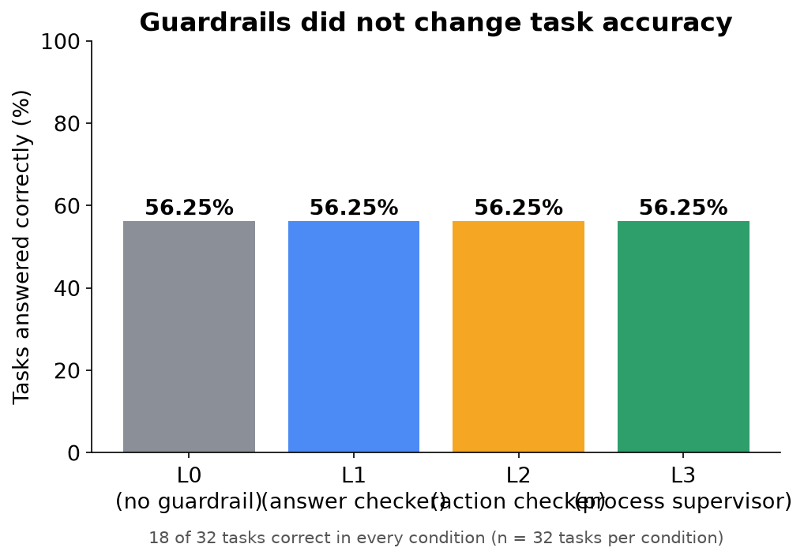
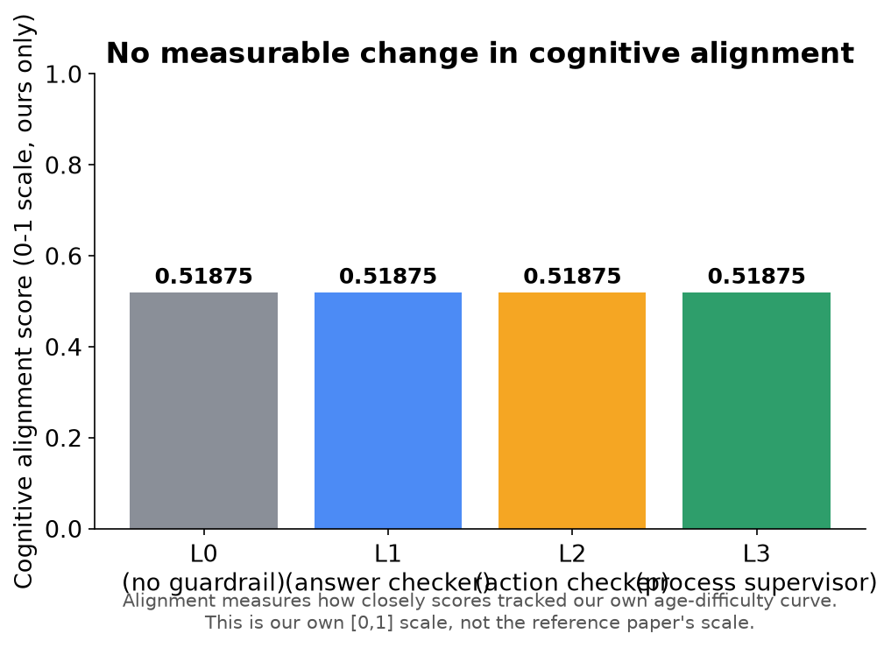
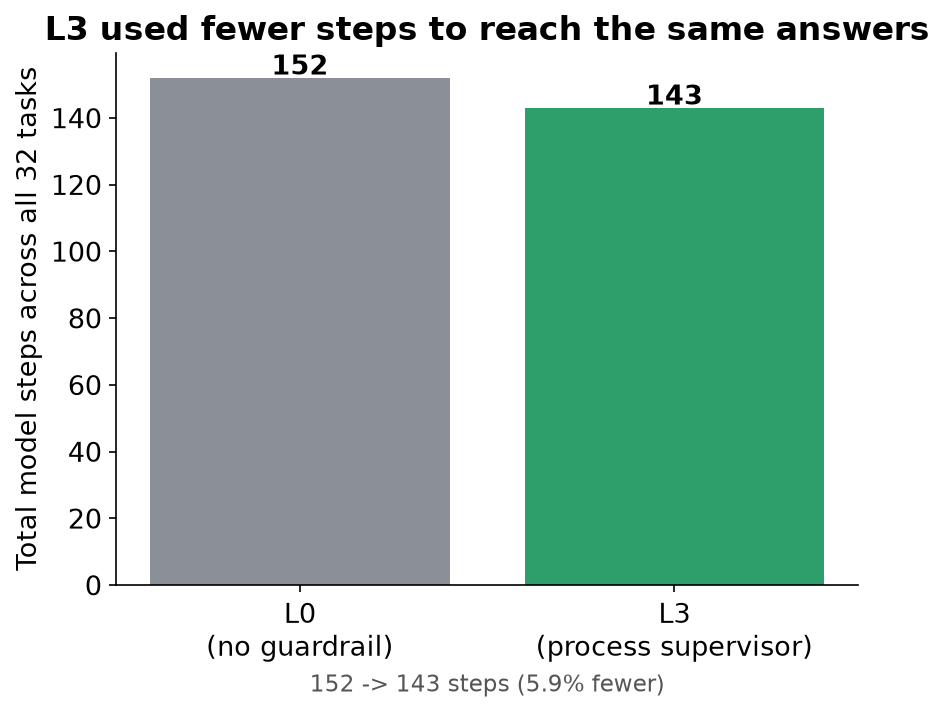
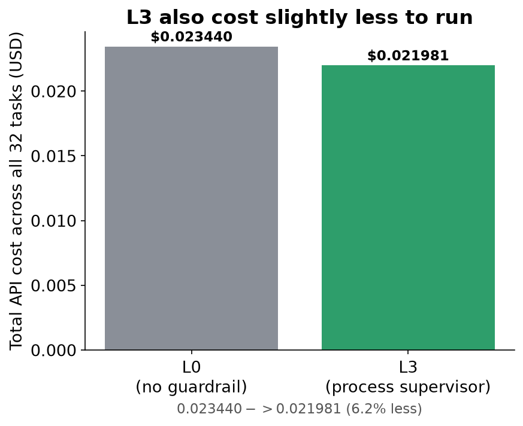
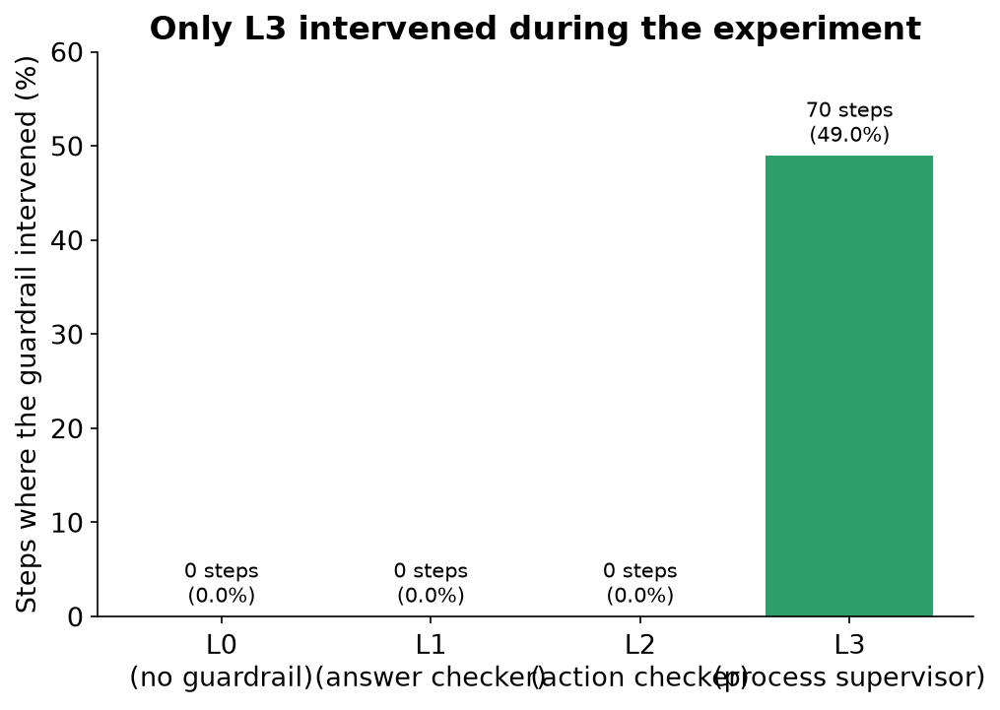
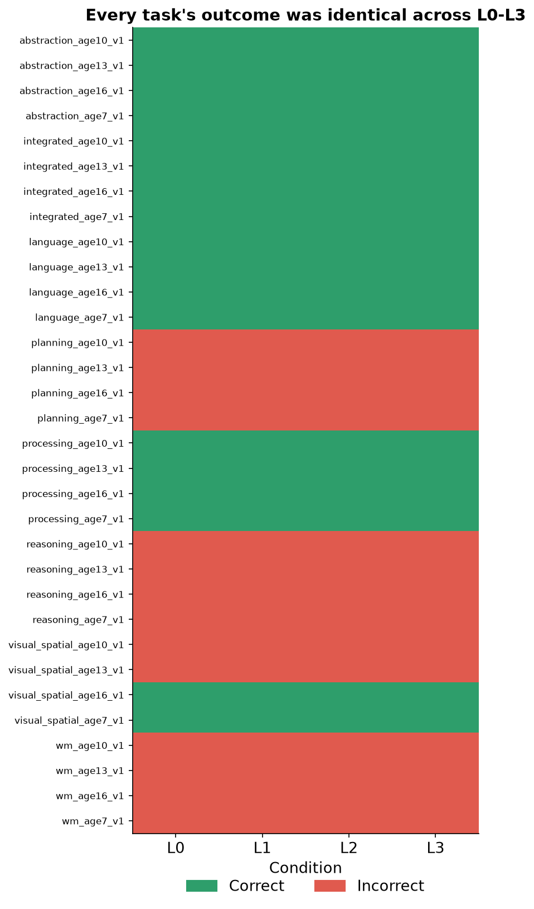
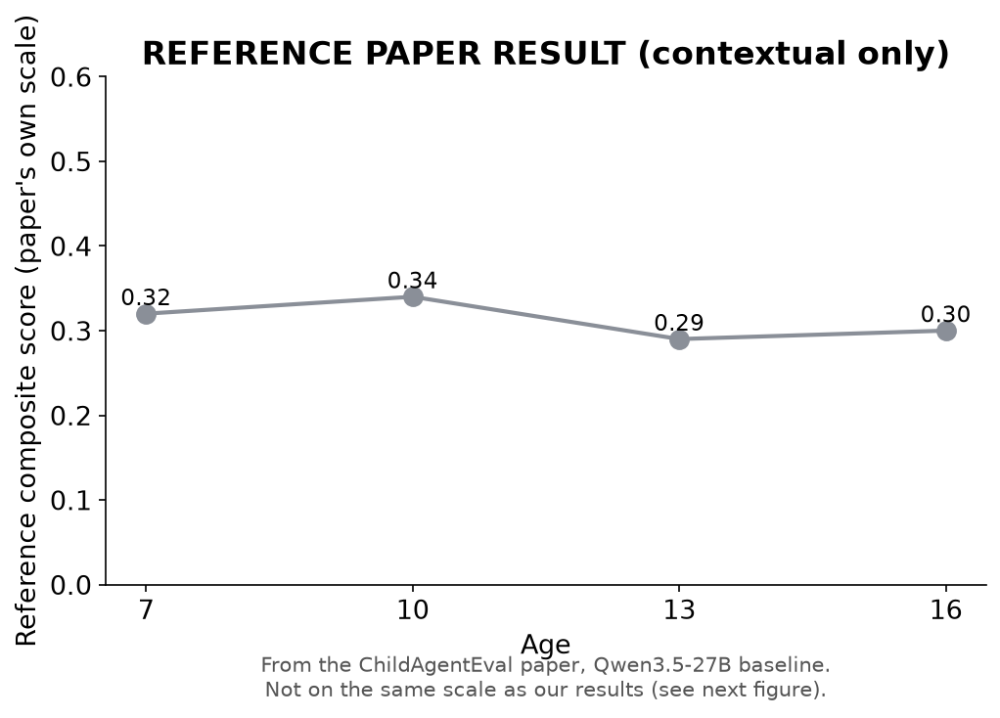
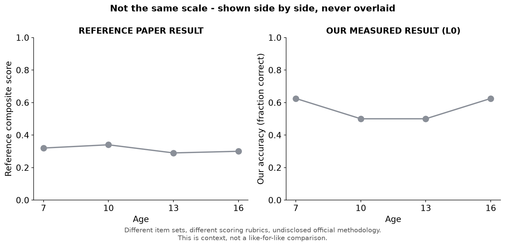
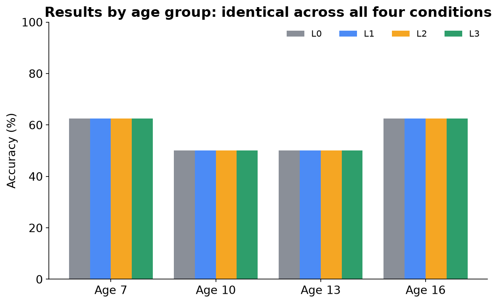
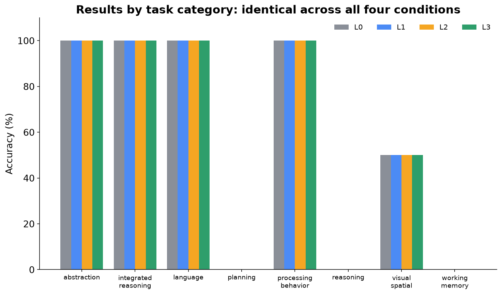

# Can Cognitive Guardrails Change AI Behavior?

### An Experimental Study with Qwen3.5-27B

*This is an independent, original benchmark inspired by the publicly described
research direction of the ChildAgentEval paper. It is **not** a reproduction of
ChildAgentEval — the official benchmark's tasks and scoring were never released
publicly, so this study built its own, separately-labeled 32-task benchmark
instead. Anywhere this document shows a number from the original paper, it is
marked **REFERENCE PAPER RESULT**.*

---

## Page 2 — The Research Question

**Do supervision systems ("guardrails") change what an AI agent actually does,
or only how it gets there?**

```
   AI Agent  --works on-->  Task  --produces-->  Behavior
                                                     |
                                     Guardrail watches / intervenes
                                                     |
                                                     v
                                                  Outcome
```

We gave an AI model 32 tasks, four different levels of supervision, and
measured what changed: **the answers it gave**, and **the path it took to get
there**.

---

## Page 3 — Why This Matters

AI agents are increasingly given autonomy to click buttons, fill forms, and
complete multi-step tasks with limited direct human oversight. A natural
question follows: if you add a supervision layer that checks the agent's
outputs, its actions, or its overall behavior, does the agent actually perform
better — or does it just look more supervised?

This matters for anyone deploying AI agents in situations where correctness
matters (education, customer support, task automation) and where "we added
safety checks" is often assumed, without being measured, to also mean "the
agent got better."

This study measures it directly, on one model, on one benchmark, under
controlled conditions — a first data point, not a final answer.

---

## Page 4 — What We Built

```
 Qwen3.5-27B  -->  Browser (Playwright)  -->  32 original tasks
                                                      |
                                        L0 / L1 / L2 / L3 guardrail layer
                                                      |
                                                      v
                                     Accuracy + Alignment + Cost + Steps
```

- **Model:** Qwen3.5-27B, accessed via OpenRouter, same settings every run
  (temperature 0, deterministic decoding).
- **Environment:** a real Chromium browser (Playwright), driven step-by-step
  by the model through generic click/type/select actions — the same way a
  human would use a web page.
- **Benchmark:** 32 original tasks we designed ourselves, spanning 8 cognitive
  categories (working memory, reasoning, abstraction, language, visual-spatial,
  planning, processing behavior, integrated reasoning) at 4 target ages
  (7, 10, 13, 16) — 1 task per category per age.
- **Guardrails:** four supervision conditions, described next.
- **Measurement pipeline:** every step, every guardrail decision, every token,
  and every dollar spent was logged automatically and scored after the fact.

---

## Page 5 — What Are L0, L1, L2, L3?

Think of it as increasing levels of a supervisor watching someone do a job:

| Level | Analogy | What it actually checks |
|---|---|---|
| **L0** | No supervisor | Nothing. The agent works alone. |
| **L1** | Answer checker | Rejects malformed / broken output *format*, before it's used. |
| **L2** | Action checker | Rejects invalid or clearly premature *actions* (e.g., giving up on step 1). |
| **L3** | Process supervisor | Watches the *whole trajectory* — steps back in if the agent stalls, loops, or repeats itself. |

Each level only adds checks; it never removes anything the level below it
does. L0 is the plain baseline every other condition is compared against.

**Guardrail** (first use): an automatic check that inspects an AI agent's
output or behavior and can reject, correct, or redirect it before it counts as
final.

---

## Page 6 — How the Experiment Worked

- **32 tasks × 4 conditions (L0, L1, L2, L3) = 128 total task-runs.**
- Every task was run once under each condition.
- Everything was held identical across conditions **except which guardrail was
  active**: same model, same tasks, same prompts, same temperature, same
  scoring rules, same step budget.
- All 128 runs were executed **in full** — nothing was skipped, re-tuned, or
  cherry-picked. A small number of runs had to be retried after
  infrastructure interruptions (background process kills, transient network
  drops); each retry is logged with its cause in the project's retry log, and
  no retry was triggered by a disliked result.
- **Trajectory** (first use): the full step-by-step sequence of actions an
  agent takes while attempting a task, from start to finish.
- **Baseline** (first use): the no-intervention condition (L0) that every
  other condition is compared against.

---

## Page 7 — Primary Result: Accuracy



### Guardrails did not change task accuracy.

All four conditions scored **18 out of 32 tasks correct (56.25%)** — exactly
the same number, exactly the same tasks. No error bars are shown because there
is only one run per condition (temperature 0, deterministic); this is a
reported count, not an estimate.

---

## Page 8 — Primary Result: Cognitive Alignment



### No measurable change in cognitive alignment.

**Cognitive alignment** (first use): our own measure of how closely an
agent's per-age performance tracks the difficulty curve we designed the
benchmark around — a single [0, 1] score, unique to this benchmark, and **not
the same scale or metric as the reference paper's composite score**.

All four conditions produced identical alignment: **0.51875**. This is our
own internal metric — it should not be read as a claim about the original
ChildAgentEval alignment metric, which was never made public.

---

## Page 9 — The Interesting Result: L3





### L3 changed the trajectory, but not the outcome.

L3 was the only condition that actually intervened during a run — **70
interventions**, mostly stepping in when the agent stalled or repeated
itself. The effect was on *efficiency*, not *correctness*:

- Steps: 152 → 143 (**~5.9% fewer**)
- Cost: $0.023440 → $0.021981 (**~6.2% less**)
- Accuracy and alignment: **unchanged**

L1 and L2 recorded **zero** interventions in this run — every output and
action they checked already passed, so their true effect (if any) remains
untested here rather than disproven.

---

## Page 10 — Task-by-Task Result



### The aggregate equality is not hiding task-level differences.

This is not just "the average was the same" — every single one of the 32
tasks landed on the identical correct/incorrect outcome in all four
conditions. Green = correct, red = incorrect, for every task and every
guardrail level.

---

## Page 11 — What Does It Mean?

**What we found**

- No measurable difference was observed in task accuracy or cognitive
  alignment across L0, L1, L2, and L3, on this benchmark, with this model, in
  this run (paired comparison, n = 32 tasks, difference = 0.000, p = 1.000
  in every comparison).
- L3 changed *how* the agent moved through tasks — fewer steps, lower cost —
  without changing *which* answers it ultimately submitted.

**What we cannot claim**

- We cannot claim guardrails "don't work" in general — only that none of the
  three guardrail designs tested changed the outcome in this specific
  experiment.
- We cannot compare our numbers directly to the original ChildAgentEval paper
  as a reproduction — its exact benchmark was never released, so our 32-task
  benchmark is a separate, original instrument. The reference figures shown
  here are context, not equivalence.
- We ran each condition once (n = 1 run, though n = 32 tasks within each
  run), at temperature 0. We do not know whether these results would
  replicate with different random seeds, other models, or a larger task set.

**What we learned**

- **[HYPOTHESIS]** L1 and L2 recorded zero interventions because this
  particular model, at temperature 0, rarely produced malformed output or
  invalid actions on these 32 tasks — so those guardrails had nothing to
  correct here, not necessarily nothing they could ever correct.
- **[HYPOTHESIS]** L3's efficiency gain without an accuracy gain suggests its
  interventions targeted redundant behavior (stalling, repeating) rather than
  wrong answers — plausible, but not proven by this data alone.

---

## Page 12 — Limitations and Next Steps

**Limitations**

- Single run per condition — no repeated trials, no variance estimate.
- 32 tasks total (4 per category, 8 per age) — a small benchmark, limited
  statistical power.
- L1 and L2 saw zero interventions in this run, so this study cannot say
  whether they would matter under different conditions.
- This is an original benchmark, not a validated psychometric instrument —
  it has not been checked against any official cognitive-age assessment.
- Only one model was tested (Qwen3.5-27B).

**What to test next**

1. Repeat the same 128-run experiment with multiple seeds per condition to
   get real variance estimates.
2. Deliberately construct tasks designed to trigger L1/L2 interventions, to
   test whether those guardrails matter when they actually fire.
3. Run the same design on additional models to see if the "no measurable
   difference" pattern holds beyond Qwen3.5-27B.
4. Expand the benchmark beyond 32 tasks to increase statistical power.
5. If official ChildAgentEval access is ever granted, run this same L0-L3
   comparison on the real benchmark as a true reproduction.
6. Investigate task-level differences in *how* wrong answers were reached
   (not just whether they were correct), using the recorded trajectories.

**Closing summary:** in this one experiment, adding supervision changed how
the agent worked without changing what it got right or wrong — a result worth
testing further, not a final verdict on whether guardrails matter.

---

## Appendix — Additional Data

These four figures provide context and breakdowns referenced above; they sit
outside the core 12-page narrative but use the same real data.

### A1. Reference paper trajectory (context only)



**REFERENCE PAPER RESULT.** Qwen3.5-27B baseline composite score by age, as
reported in the original ChildAgentEval paper (arXiv:2605.17894). Shown for
context only — see Page 8 for why this is not directly comparable to our
results.

### A2. Reference vs. our L0, side by side



Deliberately shown as two separate panels, not overlaid on one axis: the two
scores come from different item sets and different, non-commensurable scoring
systems. Putting them on one shared axis would visually imply they are the
same metric, which they are not.

### A3. Results by age group



All four conditions produced identical accuracy at every one of the four
target ages (7, 10, 13, 16) — age 7: 5/8, age 10: 4/8, age 13: 4/8, age 16:
5/8, in every condition.

### A4. Results by task category



All four conditions also produced identical accuracy in every one of the 8
task categories — perfect scores in abstraction, integrated reasoning,
language, and processing behavior; zero in planning, reasoning, and working
memory; 50% in visual-spatial. This pattern is real and identical across
L0-L3, not an averaging artifact.
